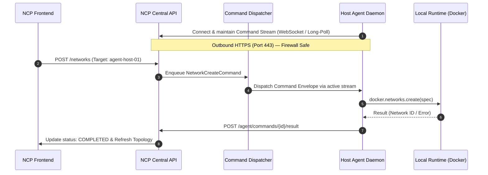

# Proposal IMP-01: Host Agent Bidirectional Command Channel

**Status:** ✅ IMPLEMENTED  
**Target Component:** `agent/network-control-plane-agent/`, `backend/app/api/v1/agent.py`  
**Priority:** High  
**Estimated Effort:** Medium (2–3 days)  

---

## 1. Problem Statement
Currently, `network-control-plane-agent` operates strictly in a **one-way push** mode:
* The agent pushes heartbeats (`/api/v1/agent/heartbeat`), inventory snapshots (`/api/v1/agent/snapshot`), and Docker runtime events (`/api/v1/agent/events`).
* However, if an operator clicks **"Create Network"**, **"Attach Container"**, or **"Revert Drift"** in the Network Control Plane UI for an agent-managed host, the central control plane cannot execute the change because remote hosts typically sit behind NAT, corporate firewalls, or lack public inbound IP addresses.

---

## 2. Proposed Solution
Implement a **secure reverse command channel** where the agent initiates and maintains an outbound connection to the central control plane to receive and execute operations:



---

## 3. Protocol & Schema Specification

### A. Command Envelope (`AgentCommandRequest`)
```python
class AgentCommandRequest(BaseModel):
    command_id: str
    host_id: str
    action: str  # e.g., "CREATE_NETWORK", "DELETE_NETWORK", "ATTACH_ENDPOINT", "DETACH_ENDPOINT"
    payload: Dict[str, Any]
    issued_at: datetime
    timeout_seconds: int = 30
```

### B. Command Execution Result (`AgentCommandResult`)
```python
class AgentCommandResult(BaseModel):
    command_id: str
    host_id: str
    success: bool
    result_data: Dict[str, Any] = Field(default_factory=dict)
    error_message: Optional[str] = None
    completed_at: datetime
```

---

## 4. Implementation Steps
1. **Agent Daemon (`daemon.py`):**
   - Add background coroutine `listen_for_commands()` using either WebSocket (`websockets` library) or HTTP long-polling (`GET /api/v1/agent/commands?host_id=...`).
   - Implement local command router (`execute_command`) mapping actions to `docker.networks.create()`, `docker.networks.get().connect()`, etc.
   - Post results back to `POST /api/v1/agent/commands/{command_id}/result`.
2. **Backend API (`backend/app/api/v1/agent.py`):**
   - Add `GET /api/v1/agent/commands` (command poll/stream).
   - Add `POST /api/v1/agent/commands/{command_id}/result`.
   - Store pending jobs in Redis / PostgreSQL task queue.
3. **Integration Tests:**
   - Add test simulating command delivery, mock Docker execution, and result acknowledgment.
