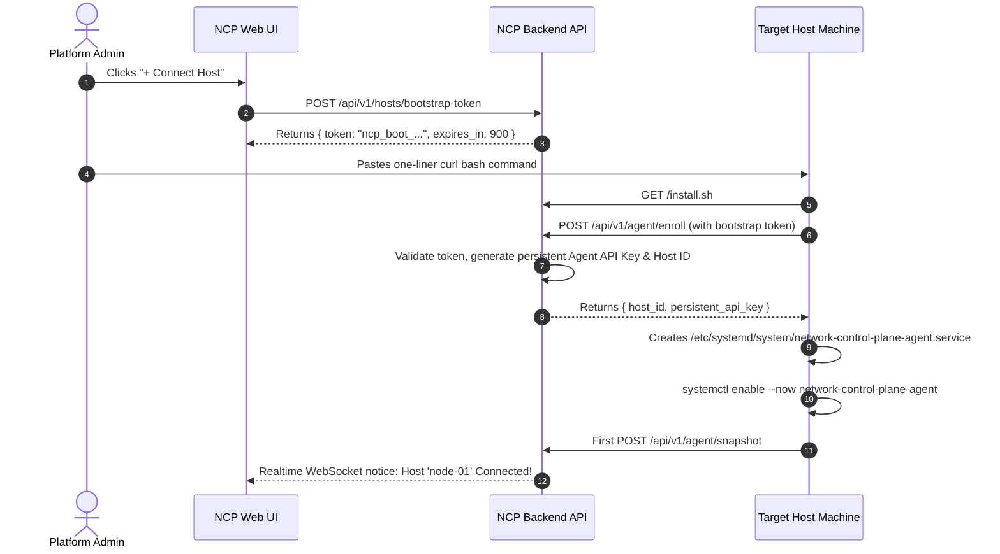

# Proposal IMP-03: One-Click Host Onboarding Wizard & Automated Bootstrap Script

**Status:** ✅ IMPLEMENTED  
**Target Component:** `frontend/src/features/topology/`, `backend/app/api/v1/hosts.py`, `scripts/`  
**Priority:** High  
**Estimated Effort:** Medium (2 days)  

---

## 1. Problem Statement
Currently, onboarding a remote host requires:
1. Manually finding or configuring an API key.
2. Manually creating a python virtual environment on the target host.
3. Installing the agent wheel via `pip`.
4. Writing a custom `systemd` service unit or starting `main.py` in the background.

This creates friction for operations teams who manage tens or hundreds of edge nodes and virtual machines.

---

## 2. Proposed Solution: One-Liner Onboarding Experience

Add a **"+ Connect Host"** button in the Network Control Plane web UI:

```text
+-----------------------------------------------------------------------+
|  🖥️ Connect Infrastructure Host                                     |
+-----------------------------------------------------------------------+
|  Choose Host OS / Environment:                                        |
|  [ Linux (x86_64 / ARM64) ]   [ Windows Server ]   [ Docker Desktop ] |
|                                                                       |
|  Run this command on your host terminal:                              |
|  +-----------------------------------------------------------------+  |
|  | curl -sSL https://ncp.corp/install.sh | sudo bash -s --        |  |
|  |   --control-plane https://ncp.corp                              |  |
|  |   --token ncp_boot_9f81a7b8e2194c6d                             |  |
|  +-----------------------------------------------------------------+  |
|  [ Copy Command ]                                                     |
|                                                                       |
|  Waiting for host heartbeat... ⏳                                     |
+-----------------------------------------------------------------------+
```

---

## 3. Architecture & Security Flow



### Security Guardrails:
* **Ephemeral Tokens:** Bootstrap tokens expire in 15 minutes and can only be used once.
* **Role Enforcement:** Only users with `admin` role can issue bootstrap tokens.
* **Audit Trail:** Every token creation and successful host enrollment creates an `AuditEvent`.
