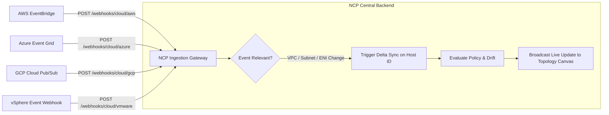

# Proposal IMP-04: Cloud Event-Driven Ingestion Webhooks

**Status:** ✅ IMPLEMENTED  
**Target Component:** `backend/app/api/v1/cloud_webhooks.py`, `backend/app/services/cloud_webhook.py`  
**Priority:** Medium  
**Estimated Effort:** Medium (2–3 days)  
**Implementation Date:** 2026-10-12  

---

## 1. Problem Statement
For external Cloud and Hypervisor platforms (AWS VPC, Azure VNet, GCP Cloud, VMware vSphere):
* Network Control Plane currently relies on **periodic polling** (e.g., every 5 to 15 minutes) to discover changes.
* **Drawbacks of Polling:**
  1. **Latency / Staleness:** If a cloud engineer creates an overlapping subnet or deletes a route table directly in the AWS/Azure console, NCP does not notice the drift until the next poll cycle.
  2. **API Rate Limiting:** High-frequency polling on large enterprise AWS/Azure subscriptions risks hitting cloud API rate limits (HTTP 429 Too Many Requests).

---

## 2. Proposed Solution: Push from Cloud into NCP via Webhooks

Configure Cloud Event Subscriptions to push notification events into a dedicated NCP Ingestion Endpoint:

---

## 3. Implementation Details
1. **Endpoint:** `POST /api/v1/webhooks/cloud/{provider_name}`
2. **Signature Verification:**
   - AWS: HMAC-SHA256 signature verification / SNS subscription confirmation.
   - Azure: Azure Event Grid validation code handshake.
   - GCP: Google Cloud Pub/Sub OIDC token verification.
3. **Delta Sync Handler:**
   - Instead of querying the entire cloud account, parse the resource ID from the event (e.g. `subnet-09f1...`) and inspect only the modified resource.
   - Immediately refresh the database and emit an SSE/WebSocket notification to the active UI topology session.
